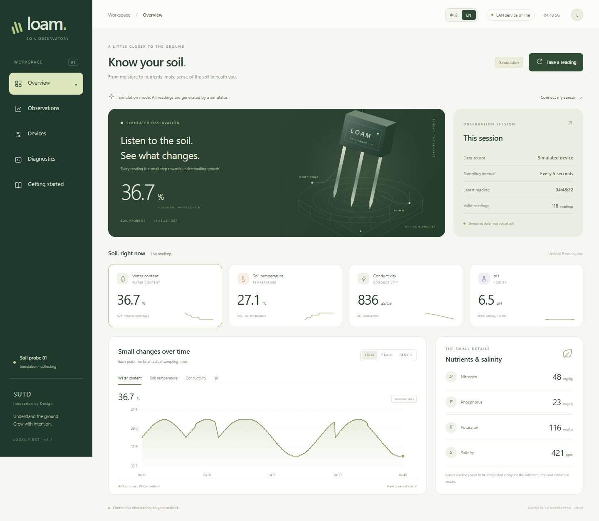
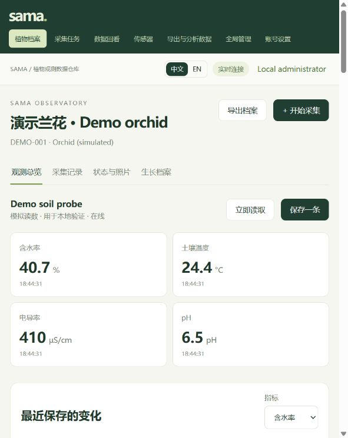
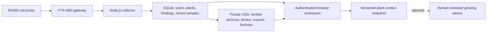

# SAMA

**Soil Analysis and Monitoring Array**
An evolving plant-observation prototype for **Innovation by Design at SUTD**.

[中文介绍](README.zh-CN.md) · [Design process](docs/DESIGN.md) · [Version history](docs/HISTORY.md) · [Cloud setup](cloud/README.md) · [API](cloud/API.md)

## From better sensing to better decisions

A grower needs more than a number on a dashboard. They need to know **which plant was measured, under what conditions, what changed, and what to check next**.

SAMA explores this problem through orchid care: moving from a soil probe and a live dashboard toward a plant-centred observation record. Project notes surfaced practical constraints around charcoal-based growing media and periods of limited supervision during displays. These observations guide prototyping; they do not establish a validated sampling method or prove that a sensor can diagnose plant health.

Our working design question is:

> How might we help orchid growers identify which plant or growing zone needs attention, and decide what to check next using traceable observations?

The project follows **Discover → Define → Develop → Deliver**, returning to earlier assumptions as prototypes reveal gaps. The intended users include orchid hobbyists and small growers; their needs, adoption and willingness to pay remain questions for further research. See [the design record](docs/DESIGN.md) for the distinction between evidence, assumptions and planned validation.

## What has been built

- **LAN prototype:** bilingual live dashboard, simulation, Modbus RTU communication through an FTX-W80 Wi-Fi bridge, gateway configuration and CSV export. Its interface retains the original **LOAM Soil Studio** name.
- **Cloud demonstration:** outbound-connected gateways, central live readings and a small recent-history store.
- **Current warehouse:** separate user accounts, administrator controls, plant profiles and care events, sensor ownership and plant-binding timelines, configurable recording segments, uploaded photographs, historical review and downloadable datasets.
- **Foundation for later analysis:** versioned `sama.plant-context.v1` snapshots with sensor metadata, units, observations, care events, photo references and data limitations. No language-model advice or autonomous care is implemented yet.

One sensor can observe different plants over time and can be reassigned between accounts by an administrator. The historical record preserves the owner and plant associated with each observation. Live readings and long-term storage are separate: users can save one reading, start or stop a segment, or schedule a segment with its own interval and full-resolution setting.





*Both screenshots use simulated data. They show software behaviour, not experimental results.*

## How observations become a usable record



The cloud service uses Node.js, SQLite in WAL mode, server-sent events and plain HTML/CSS/JavaScript. Recent samples are written locally before verified gzip NDJSON blocks are archived to private Alibaba Cloud OSS. Photos are converted to display images and thumbnails with EXIF removed. The current OSS adapter is configured for the Chengdu region; local object storage is available for development.

## Try the current version locally

Install **Node.js 24.15+** with SQLite **3.51.3+**. Node 24.x is used by CI. From the repository root:

```sh
npm ci --prefix cloud --include=optional --ignore-scripts
cd cloud
node manage.mjs demo
node server.mjs
```

Open `http://127.0.0.1:3180`. The demo command requires an empty workspace and writes generated local credentials to `cloud/data-v2/preview-credentials.txt`. It creates a simulated sensor and plant. Data and local objects stay in `cloud/data-v2/`, which Git ignores. No OSS account or physical hardware is required for this preview.

Windows users can use `cloud/start-local.ps1 -InitDemo` after installing dependencies. It maintains a separate `.preview/` workspace; see [cloud instructions](cloud/README.md).

For the earlier LAN dashboard, run `npm start` at the root and open `http://localhost:3000`. The LAN and old cloud demonstration have no account authentication and belong on trusted isolated networks.

## Tests and project layout

```sh
npm test
npm --prefix cloud test
```

The LAN suite has 18 tests; the warehouse suite has 9 integration tests covering access isolation, sensor transfers, recording, photos, archives, export, TCP framing, backups and storage-failure behaviour. CI runs both suites. This does not establish sensor accuracy or field performance.

- `server.mjs`, `lib/`, `public/`, `tests/`: original LAN application and shared protocol code.
- `cloud/`: current warehouse, database, object storage, browser application, tests and deployment templates.
- `docs/`: design rationale, architecture, release history and validation scope.

The public history preserves [`lan-v1.1.0`](https://github.com/XiaoMingAXX/SAMA/tree/lan-v1.1.0), [`cloud-v0.1.0`](https://github.com/XiaoMingAXX/SAMA/tree/cloud-v0.1.0) and [`cloud-v0.2.0`](https://github.com/XiaoMingAXX/SAMA/tree/cloud-v0.2.0). These commits were reconstructed from existing snapshots at publication time; they are not the original development timeline.

## Next design and engineering questions

Validate probe calibration and representative sampling in actual orchid substrates; verify the gateway registration behaviour on physical hardware; test sustained workloads near the intended scale of fewer than ten gateways/sensors and roughly 500 plant profiles; then evaluate whether contextual analysis helps users make better care decisions.

Production deployment requires HTTPS, a private object store, dedicated credentials, backup/restore planning and a protected gateway connection. The gateway protocol is currently plaintext TCP: its registration secret does not encrypt measurements. See [deployment preparation](docs/DEPLOYMENT.md) and [known limits](docs/VALIDATION.md).

## License

[MIT](LICENSE). Third-party dependencies retain their own licenses. This is a course project repository, not an official SUTD product. Raw participant material, private deployment details, credentials and operational datasets are excluded.
